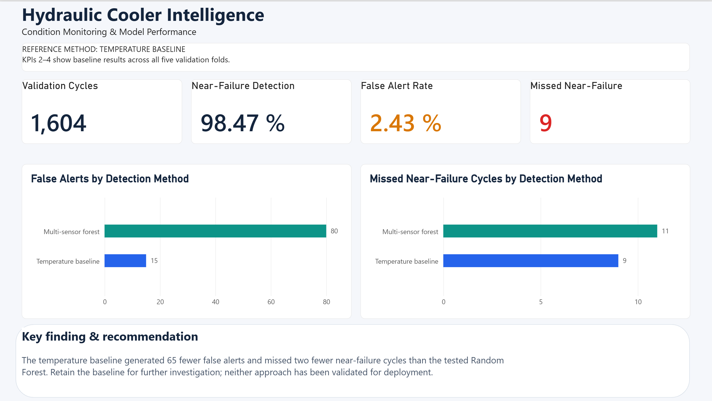
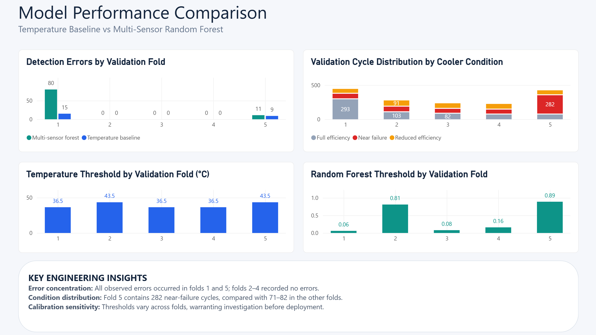
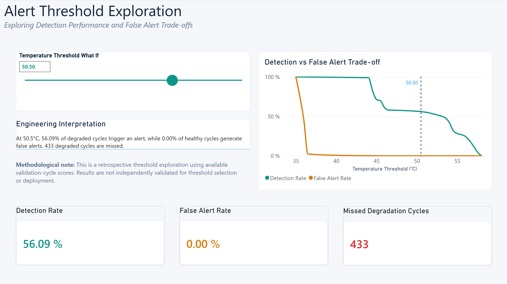
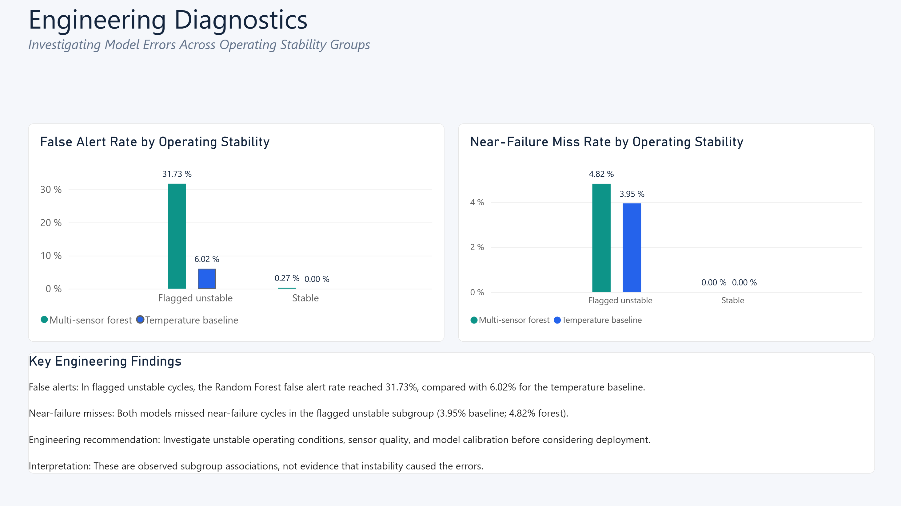

# Hydraulic Cooler Intelligence

### Engineering analytics | Condition monitoring | Python + Power BI

**Can a multi-sensor machine-learning model improve hydraulic cooler condition detection enough to justify its added complexity?**

This project compares a simple temperature-based alert rule with a multi-sensor Random Forest and turns the findings into a four-page interactive Power BI dashboard. The focus is on engineering decision support: **detecting degraded cooler conditions while avoiding unnecessary alerts**, understanding where models fail, and evaluating the evidence required before a real-world pilot.



> **Main finding:** In the tested five-fold, group-aware validation procedure, the simpler temperature baseline produced **15 unnecessary alerts and 9 missed near-failure cycles**, versus **80 unnecessary alerts and 11 missed near-failure cycles** for the multi-sensor Random Forest. The evidence supports retaining the temperature rule as the **comparison baseline for further investigation**, not deploying a fixed alert threshold.


## Explore the Project

- 📊 [Power BI Dashboard](powerbi/Hydraulic_Cooler_Intelligence.pbix)
- 🐍 [Python Analysis Notebook](notebooks/)
- 📁 [Processed Validation Datasets](data/processed/model_comparison/)
- 🖼️ [Dashboard Screenshots](screenshots/)

## Project at a glance

| Area | Details |
|---|---|
| Business / engineering question | Is extra sensor and model complexity justified by better cooler-condition alert performance? |
| Dataset | [UCI Condition Monitoring of Hydraulic Systems](https://archive.ics.uci.edu/dataset/447/condition%2Bmonitoring%2Bof%2Bhydraulic%2Bsystems) |
| Observations | 2,205 measured 60-second cycles from one hydraulic test rig |
| Main evaluation | 1,604 development cycles, with one excluded-group prediction per cycle **per model** |
| Models | TS1 mean-temperature threshold; multi-sensor Random Forest |
| Tools | Python, pandas, scikit-learn, Power BI, Power Query, DAX |
| Deliverable | Four-page interactive Power BI report |

## Why this matters

Monitoring systems must balance **missed degradation** against **unnecessary alerts**. A more complex model is not automatically more useful: it may require additional processing, validation, maintenance, and monitoring without reducing alert errors. This case study illustrates how to compare alternatives using severity-specific measures and a decision-oriented dashboard rather than relying on overall accuracy alone.

**Scope:** This is **current cooler-condition detection**, not prediction of when a machine will fail. Each cycle is a measurement from an experiment, not a separate breakdown or maintenance visit.

## Dataset and target

The [UCI dataset](https://doi.org/10.24432/C5CW21) contains 2,205 cycles collected from a hydraulic test rig, covering measurements from 14 physical sensors: six pressure, four temperature, two flow, one motor-power, and one vibration sensor. Three additional derived efficiency-related signals exist in the source dataset but were excluded from this comparison.

Cooler labels are:

| Cooler code | Recorded condition | Binary alert target |
|---|---|---|
| `100` | Full efficiency | Healthy |
| `20` | Reduced efficiency | Degraded |
| `3` | Close to total failure | Degraded (near failure) |

The dataset also contains a **stability flag**. Here, `1` denotes cycles for which static operating conditions might not yet have been reached; it is used for **diagnosis, not prediction**.

## Approach

1. **Prepare the data.** Align cycle-level labels with sensor measurements and compute per-cycle mean and population standard deviation for 14 physical sensors (28 summary features). The time sequence inside each cycle is not modeled.
2. **Define comparable methods.** The temperature baseline alerts on the mean of sensor TS1. The Random Forest uses the multi-sensor summaries (200 trees, maximum depth 8, minimum leaf size 3).
3. **Use a group-aware evaluation.** Reserve 601 cycles from the original split, and perform five grouped validation rounds across the remaining 1,604 development cycles. Groups represent exact combinations of cooler, valve, pump, and accumulator conditions. Each round separates model fitting, threshold calibration, and excluded-group validation.
4. **Compare operationally meaningful errors.** Report missed near-failure cycles, missed reduced-efficiency cycles, healthy false alerts, detection rate, and false-alert rate. Pooled rates are calculated from pooled counts, not averaged fold percentages.
5. **Investigate error concentration.** Examine results by validation fold and by the recorded stability flag.
6. **Build an interactive Power BI report.** Provide a management overview, fold comparison, retrospective threshold exploration, and subgroup diagnostics.

### Main model results

| Metric | Temperature baseline | Multi-sensor Random Forest |
|---|---:|---:|
| Validation cycles | 1,604 | 1,604 |
| Degradation detection rate | **99.09%** | 98.88% |
| Healthy false-alert rate | **2.43%** | 12.94% |
| Unnecessary alerts | **15** | 80 |
| Missed near-failure cycles | **9** | 11 |
| Missed reduced-efficiency cycles | 0 | 0 |

**Interpretation:** Under the tested feature preparation, hyperparameters, and fold-specific threshold calibration, the forest generates 65 additional healthy false alerts and misses two more near-failure cycles. This evaluates the **complete procedures**, not the intrinsic value of adding sensors in isolation.

## Interactive dashboard

The Power BI report, `powerbi/Hydraulic_Cooler_Intelligence.pbix`, contains four pages:

### 01 — Executive Overview


Summary KPIs, overall error comparison, and the provisional engineering recommendation. Baseline-specific KPI values are labeled as such.

### 02 — Model Comparison



Detection errors by fold, cooler-condition distribution, and method-specific thresholds. The temperature thresholds are in **°C**, while forest score thresholds are **unitless** and are not numerically comparable.

### 03 — Alert Optimization



An interactive what-if temperature slider updates detection rate, false-alert rate, missed degradation counts, and a dynamic interpretation. A threshold-sweep chart shows the retrospective trade-off across 35–58°C.

> **Important:** These slider calculations reapply a shared threshold to available development-cycle scores **after the data have been explored**. They are **retrospective sensitivity analysis**, not independent validation, a recommended universal threshold, or projected field performance. They are distinct from the fold-specific calibration used for the main comparison.

### 04 — Engineering Diagnostics



Rates of healthy false alerts and near-failure misses by stable versus flagged unstable cycles. The observed subgroup difference motivates further engineering investigation; **it does not establish that instability caused the errors**.

## Key diagnostic findings

- **Fold concentration:** All healthy false alerts occurred in validation fold 1; all near-failure misses occurred in fold 5. Folds 2–4 had no observed errors.
- **Calibration variation:** Selected baseline thresholds ranged from **36.5°C to 43.5°C**; forest thresholds ranged from **0.06 to 0.89** on a different, unitless scale.
- **False alerts in flagged unstable, healthy cycles:** **6.02%** for the baseline versus **31.73%** for the forest.
- **Near-failure misses in flagged unstable cycles:** **3.95%** for the baseline versus **4.82%** for the forest. No near-failure misses were observed in stable cycles.

These observations suggest investigating operating transitions, feature preparation, calibration coverage, and model behavior before trying a more complex method.

## Project files

```text
Hydraulic-Cooler-Intelligence/
├── README.md
├── data/
│   └── processed/
│       └── model_comparison/
│           ├── cv_cycle_predictions.csv
│           ├── cv_fold_results.csv
│           ├── fold_diagnostics.csv
│           ├── model_comparison.csv
│           └── subgroup_comparison.csv
├── notebooks/                     # Place the source Python notebook here
├── powerbi/
│   └── Hydraulic_Cooler_Intelligence.pbix
└── screenshots/
    ├── 01_Executive_Overview.png
    ├── 02_Model_Comparison.png
    ├── 03_Alert_Optimization.png
    └── 04_Engineering_Diagnostics.png
```

The five small CSVs are **exported analytical outputs**, not the original raw sensor data. The original sensor data can be obtained from UCI. To fully reproduce the analysis, include the actual Python notebook and its source-data instructions in this repository.

**Viewing the dashboard:** Open the `.pbix` file using Power BI Desktop. The screenshots provide a preview without requiring Power BI.

## Limitations and next steps

- Data come from **one test rig** with repeated measurement cycles, so results do not establish generalization to independent equipment or operating environments.
- The preserved 601-cycle set was already inspected during earlier exploratory work; it is **not a fresh untouched test set**.
- Grouping reduces one form of overlap but does not guarantee complete independence or remove all temporal dependence.
- Thresholds differ across folds, and findings may be sensitive to calibration-group coverage.
- No field deployment, detection-delay study, maintenance cost evaluation, downtime reduction, or safety benefit has been demonstrated.
- Counts of flagged cycles are **not** counts of inspection visits, breakdowns, or independent failures.

**Suggested follow-up:** Collect independent equipment data across operating transitions, investigate folds 1 and 5, define severity-specific acceptable misses and review capacity with engineers, then evaluate alert episodes and detection delay before a pilot.

## Skills demonstrated

**Python / machine learning:** cycle-level preprocessing, feature engineering, grouped validation, Random Forest, model calibration, error analysis.

**Power BI / analytics:** Power Query data cleaning, DAX measures, interactive what-if parameters, dynamic explanatory text, validation visualizations, dashboard design.

**Engineering and business analysis:** comparing technical alternatives, interpreting alert-quality trade-offs, communicating limits and decision implications.

## Data source and credit

Helwig, N., Pignanelli, E., & Schütze, A. *Condition monitoring of hydraulic systems* [Dataset]. UCI Machine Learning Repository. [https://doi.org/10.24432/C5CW21](https://doi.org/10.24432/C5CW21). Distributed under [CC BY 4.0](https://creativecommons.org/licenses/by/4.0/).

Related methods paper: Helwig, N., Pignanelli, E., & Schütze, A. (2015). *Condition Monitoring of a Complex Hydraulic System Using Multivariate Statistics*. DOI: [10.1109/I2MTC.2015.7151267](https://doi.org/10.1109/I2MTC.2015.7151267).
